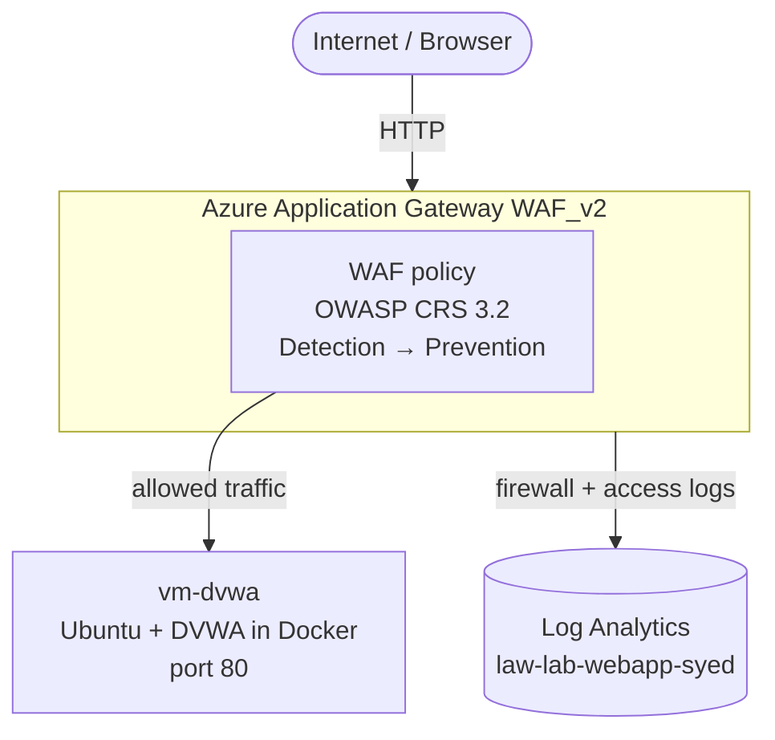
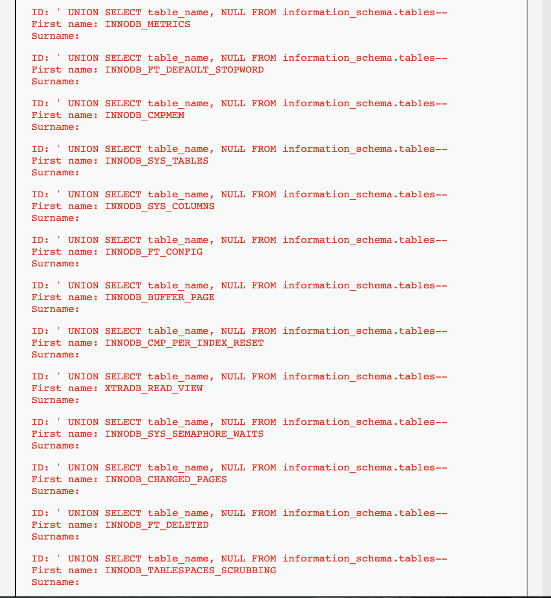
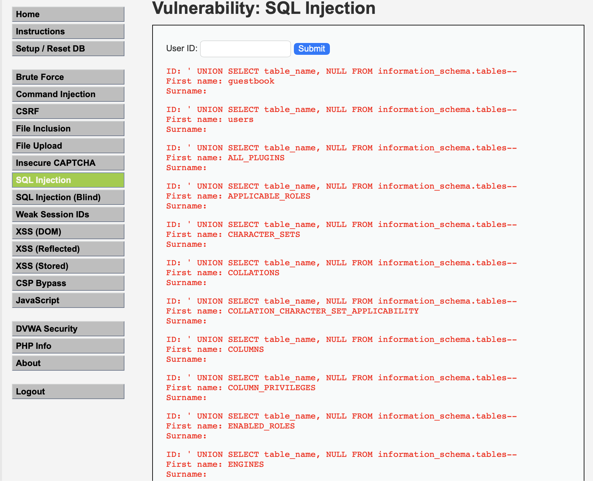
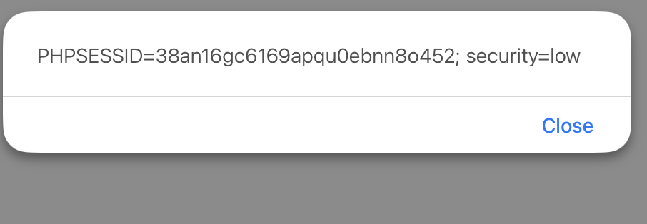
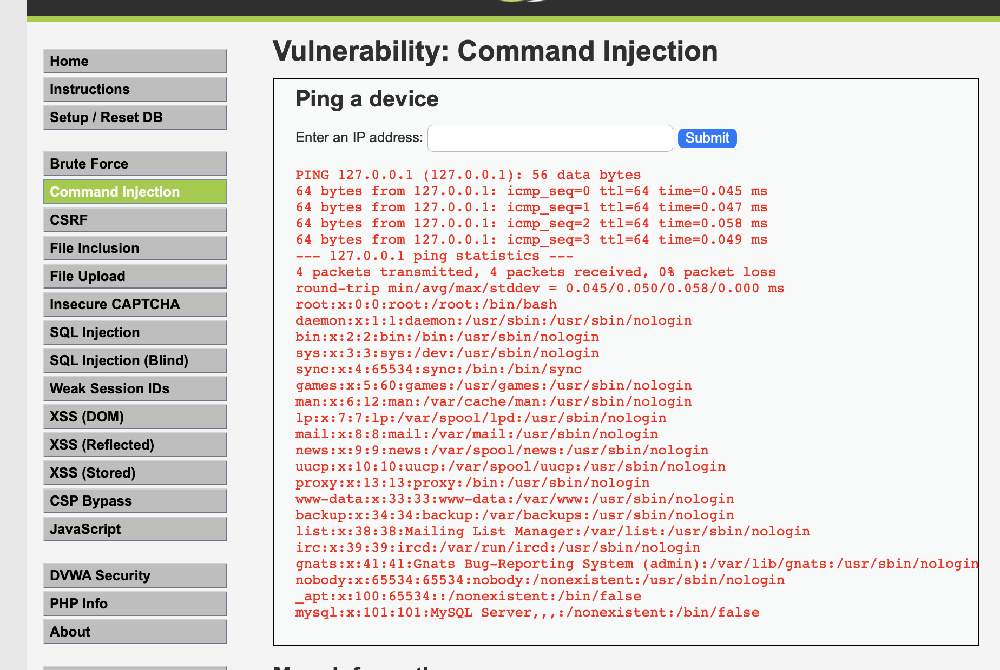
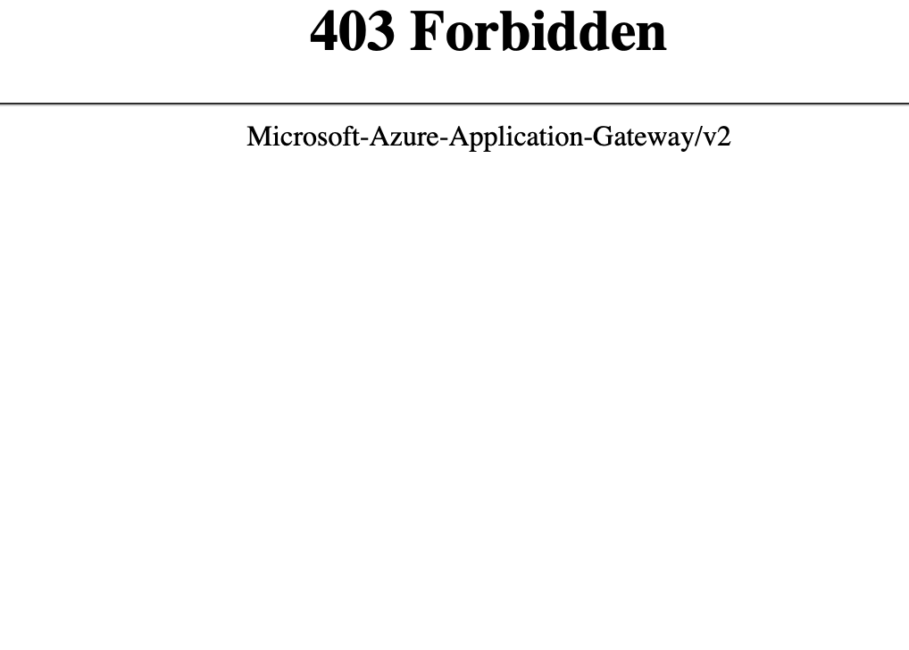
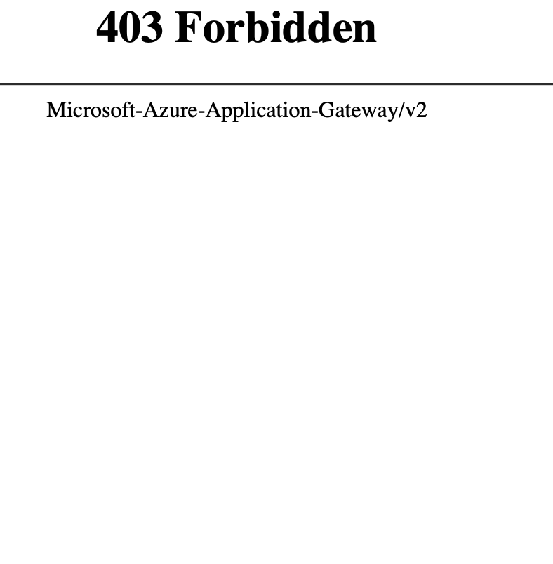
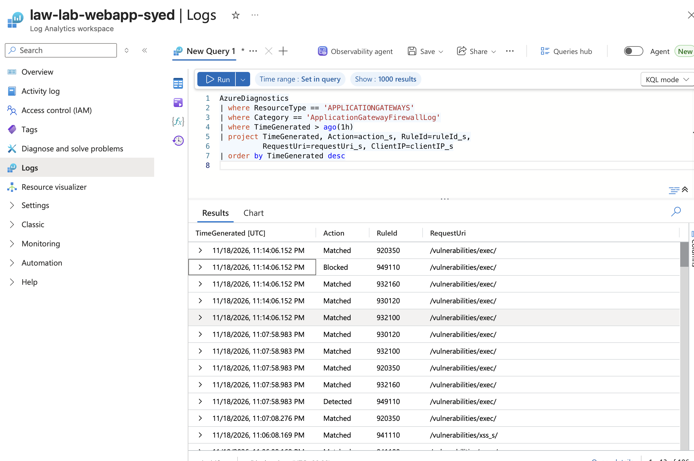
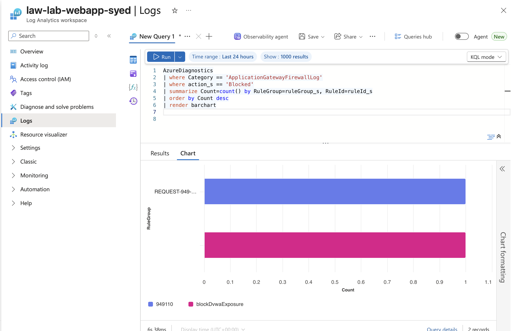

# Web Application Security: DVWA Behind Azure Application Gateway WAF

**Status:** ✅ Built and tested

## Video Walkthrough

> 🎥 Loom walkthrough coming soon

## Project Overview

In this lab I deployed the Damn Vulnerable Web Application (DVWA) behind an **Azure Application Gateway** with the **Web Application Firewall (WAF_v2)** enabled, to show the difference a WAF makes against real web attacks. I first ran SQL injection, stored XSS, and command injection against the application with the WAF in **Detection mode**, where every attack succeeded and was only logged. I then switched the WAF policy to **Prevention mode** and re-ran the same attacks, this time getting **403 Forbidden** at the gateway before the requests ever reached the app. Finally I wrote a **custom WAF rule** and analyzed all the firewall activity with **KQL** in Log Analytics.

The whole environment is defined with **Terraform**, so it can be stood up and torn down repeatably. The WAF policy is a standalone resource attached to the gateway via `firewall_policy_id`, which keeps the firewall mode, managed rules, and custom rules cleanly separated from the gateway configuration.

### Skills Demonstrated

- **Infrastructure as Code:** full environment provisioned with Terraform, including a standalone WAF policy
- **Azure networking:** Application Gateway (layer 7), virtual network, and subnets for gateway and backend
- **Web application security:** SQL injection, stored XSS, and command injection against a controlled target
- **Defensive security:** OWASP Core Rule Set 3.2, Detection vs Prevention mode, and a custom match rule
- **Log analysis:** querying and charting WAF firewall logs with KQL in Log Analytics

## Architecture Diagram



## Prerequisites

- Active Azure subscription
- Terraform installed and Azure CLI authenticated
- Basic DVWA familiarity (helpful but not required)

## Naming Conventions

| Resource | Name |
| --- | --- |
| Resource group | `rg-lab-webapp-syed` |
| Virtual network | `vnet-webapp-syed` |
| DVWA virtual machine | `vm-dvwa-syed` |
| Public IP | `pip-appgw-syed` |
| Application Gateway | `appgw-waf-syed` |
| WAF policy | `wafpol-syed` |
| Log Analytics workspace | `law-lab-webapp-syed` |

## Project Steps

### 1. Deploy the environment with Terraform

The environment is defined in `main.tf` and `variables.tf`. Applying it creates the network, the DVWA VM (DVWA runs in Docker via a custom-data startup script), the Application Gateway with WAF_v2, the attached WAF policy, and a Log Analytics workspace wired up with diagnostic settings.

```
terraform init
terraform apply
```

The Application Gateway takes several minutes to provision. Once it finishes, the public IP comes from `terraform output appgw_public_ip`.

### 2. Run the attacks in Detection mode

With the WAF in **Detection mode**, it logs attacks but still forwards them to the app, so all three attacks succeed. I set the DVWA security level to **Low** first.

**SQL injection** — a `UNION`-based payload in the User ID field dumps the database structure from `information_schema.tables`, exposing internal table names including `users` and `guestbook`:

```
' UNION SELECT table_name, NULL FROM information_schema.tables-- 
```

 

**Stored XSS** — a script saved to the guestbook runs in the browser of everyone who views the page and leaks the session cookie, the same mechanism used to hijack a session:

```
<script>alert(document.cookie)</script>
```



**Command injection** — the ping form passes input straight to the shell, so chaining a second command with `;` returns the contents of `/etc/passwd` and exposes every system account:

```
127.0.0.1; cat /etc/passwd
```



### 3. Switch the WAF to Prevention mode

Changing `mode` from `Detection` to `Prevention` in the WAF policy and re-applying turns "log only" into "log and block." Re-running all three attacks now returns **403 Forbidden** from the Application Gateway. The request is dropped at the edge and never reaches DVWA.

```
# In the azurerm_web_application_firewall_policy resource
mode = "Prevention"   # was "Detection"
```



### 4. Write a custom WAF rule

The OWASP managed rules cover common attacks, but organizations often need to block their own patterns. I added a custom rule that blocks any request with `dvwa` in the query string, simulating blocking the exposure of an internal application name:

```
custom_rules {
  name      = "blockDvwaExposure"
  priority  = 1
  rule_type = "MatchRule"
  action    = "Block"

  match_conditions {
    match_variables {
      variable_name = "QueryString"
    }
    operator           = "Contains"
    negation_condition = false
    match_values       = ["DVWA", "dvwa"]
  }
}
```

A request to `?test=dvwa` is blocked by the custom rule, while a clean query string loads normally, confirming the custom rule rather than the managed set did the blocking.



### 5. Analyze the WAF logs with KQL

All WAF events flow to Log Analytics. This query lists every rule match in the last hour:

```
AzureDiagnostics
| where ResourceType == "APPLICATIONGATEWAYS"
| where Category == "ApplicationGatewayFirewallLog"
| where TimeGenerated > ago(1h)
| project TimeGenerated, action_s, ruleId_s, Message, requestUri_s, clientIp_s
| order by TimeGenerated desc
```

The results show the same rules logged as `Detected` during the Detection-mode runs and `Blocked` after the switch to Prevention, against paths like `/vulnerabilities/exec/` and `/vulnerabilities/xss_s/`.



This second query charts blocked requests by rule:

```
AzureDiagnostics
| where Category == "ApplicationGatewayFirewallLog"
| where action_s == "Blocked"
| summarize Count = count() by ruleGroup_s, ruleId_s
| order by Count desc
| render barchart
```

The chart shows both blocking rules side by side: the OWASP anomaly-scoring rule `949110` and the custom `blockDvwaExposure` rule.



## Verification Checklist

- [x] Terraform applies cleanly and the gateway returns the DVWA login page
- [x] SQL injection, stored XSS, and command injection all succeed in Detection mode
- [x] All three attacks return 403 after switching to Prevention mode
- [x] Custom rule blocks `dvwa` in the query string while clean requests load
- [x] WAF firewall logs appear in Log Analytics and the KQL queries return data

## Troubleshooting

| Issue | Cause | Fix |
| --- | --- | --- |
| DVWA login fails with `admin` / `password` | Database not initialized | Open `/setup.php` and click **Create / Reset Database** before logging in |
| `terraform apply` fails with `CustomRuleInvalidName` | WAF custom rule names cannot contain hyphens | Use an alphanumeric name such as `blockDvwaExposure` |
| Test URL shows a blank `about:blank` page | URL never navigated, or `https` used on an HTTP-only listener | Enter the full `http://<gateway-ip>/?test=dvwa` and press Enter |
| KQL query returns no results | WAF logs take 5–15 minutes to reach Log Analytics | Wait a few minutes and re-run the query |

## Cleanup

The WAF_v2 gateway and the VM incur ongoing cost, so the environment is destroyed when finished:

```
cd ~/labs/lab03-webapp
terraform destroy
```

## Key Takeaways

- **Detection vs Prevention** is the line between watching an attack and stopping it at the edge, before it reaches the application.
- A WAF is **signatures plus tuning**: the OWASP Core Rule Set catches common attacks, and custom rules extend it to an organization's own patterns.
- **Infrastructure as Code** makes a security control auditable and repeatable; the firewall mode is a one-line, version-controlled change.
- **Logging is the other half of a WAF.** KQL turns raw firewall events into a clear picture of what was tried and what was blocked.

---

*Built by Syed Shah · [github.com/salmanshah4](https://github.com/salmanshah4) · Time to complete: ~3 hours*
